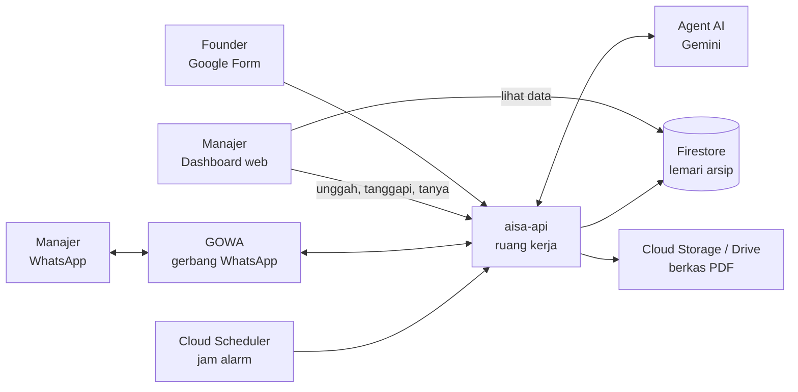
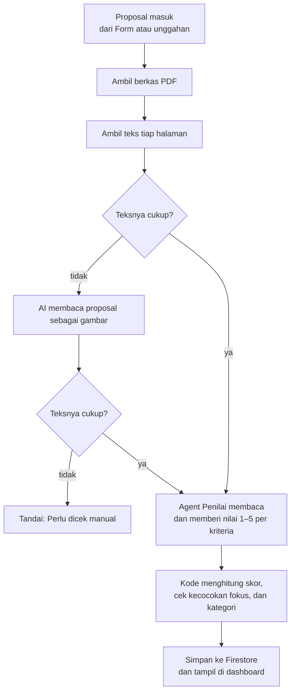

# Arsitektur AISA, dijelaskan dengan sederhana

Dokumen ini untuk siapa saja yang ingin tahu **cara kerja AISA di balik layar**, tanpa
perlu paham pemrograman. Penjelasan teknis yang lengkap ada di
[`explanation/architecture.md`](explanation/architecture.md).

## AISA itu apa?

AISA adalah **asisten AI untuk tim investasi**. Setiap ada startup yang mengirim proposal
(berkas presentasi PDF, biasa disebut _pitch deck_), AISA:

1. **membaca dan menilai** proposal itu dengan lima kriteria: Tim, Pasar & masalah, Produk &
   keunggulan, Traksi, serta Model bisnis & keuangan;
2. **mengelompokkan** hasilnya, misalnya _Sangat cocok_, _Cocok_, atau _Kurang cocok_;
3. **melapor** lewat WhatsApp setiap pukul 09.00 dan 17.00;
4. **menjawab pertanyaan** manajer, baik di dashboard (Tanya AISA) maupun di WhatsApp.

Keputusan akhir, yaitu mengundang, memantau, atau mengarsipkan startup, **tetap di tangan
manusia**. AISA hanya membantu menyaring dan merangkum.

## Gambaran besar

Bayangkan AISA seperti sebuah kantor kecil:

- **Dashboard** adalah **ruang depan**. Di sinilah manajer melihat daftar proposal, nilai,
  grafik, dan biaya AI.
- **aisa-api** adalah **ruang kerja di belakang**. Di sinilah semua pekerjaan dilakukan:
  menerima proposal, memanggil AI, menghitung skor, dan mengirim WhatsApp.
- **Firestore** adalah **lemari arsip**. Semua data disimpan di sini.
- **Para agent AI** adalah **staf ahli** yang dipanggil saat perlu membaca atau menulis.

Ada satu aturan penting: **dashboard hanya membaca data, tidak pernah menulis sendiri.**
Setiap perubahan, misalnya menanggapi proposal atau mengubah aturan penilaian, selalu lewat
aisa-api. Dengan begitu hanya ada satu pintu untuk mengubah data, sehingga lebih mudah
dijaga dan diperiksa.

## Dua aplikasi utama

| Aplikasi      | Tugasnya                                                                                   | Dibuat dengan                      |
| ------------- | ------------------------------------------------------------------------------------------ | ---------------------------------- |
| **Dashboard** | Tampilan web untuk manajer: daftar proposal, detail, tren, riwayat, aturan, biaya AI.      | Next.js (React), bahasa TypeScript |
| **aisa-api**  | Mesin di belakang: menerima proposal, menilai, mengirim ringkasan, membalas WhatsApp, dll. | FastAPI, bahasa Python             |

Keduanya dibungkus sebagai **container** (semacam paket siap jalan) lalu dijalankan di
**Cloud Run**, di wilayah Jakarta (`asia-southeast2`).

## Bagaimana sebuah proposal dinilai

Proposal hasil pindai yang hampir tanpa teks tidak langsung ditolak: AI menyalin dulu teks yang
terlihat di tiap halamannya, lalu proposal dinilai seperti biasa. Hanya proposal yang tetap tidak
terbaca, atau yang lebih dari 15 MB atau 50 halaman, yang ditandai _Perlu dicek manual_.

Pembagian kerjanya disengaja:

- **AI hanya memberi nilai per kriteria**, lengkap dengan kutipan dan nomor halaman dari
  proposal sebagai bukti.
- **Skor akhir dan kategori dihitung oleh kode biasa**, memakai bobot dari halaman _Aturan
  penilaian_. Jadi angka akhirnya bisa ditelusuri, dan bila bobot diubah, hasilnya berubah
  dengan cara yang bisa diprediksi.
- Setiap langkah dicatat dengan jamnya, dan bisa dilihat di **Log penilaian** pada halaman
  detail proposal.

## Para agent AI

Semua agent memakai model **Gemini 3.8 Flash** dari Google, lewat **Vertex AI**.

| Agent                         | Tugas                                                                                                  | Batasannya                                                                                  |
| ----------------------------- | ------------------------------------------------------------------------------------------------------ | ------------------------------------------------------------------------------------------- |
| **Penilai**                   | Membaca proposal, memberi nilai 1–5 per kriteria dengan kutipan halaman, dan mengambil profil startup. | Tidak menentukan skor akhir maupun kategori; itu dihitung kode.                             |
| **Insight** dan **Ringkasan** | Merangkai kalimat untuk laporan WhatsApp pukul 09.00 dan 17.00.                                        | Angka dihitung kode. Bila AI menulis angka yang tidak ada di data, laporan memakai templat. |
| **Asisten**                   | Menjawab pertanyaan manajer di Tanya AISA dan di WhatsApp.                                             | **Hanya bisa membaca** data; tidak bisa mengubah apa pun.                                   |

### Asisten dan Google ADK

Asisten dibuat dengan **Google ADK (Agent Development Kit)**, yaitu perangkat dari Google
untuk membangun agent AI. Cara kerjanya sederhana:

- Asisten diberi **8 "alat"** untuk membaca data, misalnya ringkasan semua proposal, mencari
  proposal, menghitung jumlah, melihat detail, membandingkan, melihat riwayat, melihat tren,
  dan melihat aturan penilaian.
- Saat ditanya, Asisten **memilih sendiri alat mana yang perlu dipakai**, mengambil datanya,
  lalu menyusun jawaban dalam bahasa sehari-hari.
- Asisten dijalankan di **Vertex AI Agent Runtime**, layanan Google untuk menjalankan agent,
  lengkap dengan:
  - **Sessions**: mengingat isi percakapan yang sedang berjalan, jadi pertanyaan lanjutan
    seperti "yang kedua bagaimana?" tetap nyambung;
  - **Memory Bank**: mengingat **preferensi** manajer dalam jangka panjang, misalnya gaya
    jawaban yang disukai. Data proposal sengaja tidak dikirim ke sini.

Bila sebuah proposal dihapus, percakapan Asisten dan ingatan yang menyebut proposal itu ikut
dibersihkan.

### Perintah WhatsApp tidak lewat AI

Pesan WhatsApp seperti `STOP`, `LANJUT`, atau perintah menanggapi proposal **dikenali oleh
kode biasa, bukan AI**. Tujuannya supaya perintah yang mengubah data selalu dipahami dengan
pasti. Hanya pertanyaan bebas yang diteruskan ke Asisten.

## Layanan Google yang dipakai

| Layanan                        | Fungsinya di AISA                                                                            |
| ------------------------------ | -------------------------------------------------------------------------------------------- |
| **Cloud Run**                  | Menjalankan dashboard dan aisa-api, dan menambah server sendiri bila pemakaian sedang ramai. |
| **Firestore**                  | Database utama: proposal, hasil penilaian, riwayat, aturan, catatan pekerjaan AI.            |
| **Cloud Storage**              | Menyimpan PDF yang diunggah lewat dashboard. Pratinjau memakai tautan sementara (15 menit).  |
| **Google Drive**               | Tempat PDF dari Google Form tersimpan; AISA mengambilnya dari sini.                          |
| **Google Forms + Apps Script** | Formulir untuk founder. Begitu dikirim, Apps Script meneruskannya ke aisa-api.               |
| **Vertex AI (Gemini)**         | Model AI yang dipakai semua agent.                                                           |
| **Vertex AI Agent Runtime**    | Rumah bagi Asisten, termasuk Sessions dan Memory Bank.                                       |
| **Cloud Scheduler**            | "Jam alarm": ringkasan pukul 09.00 dan 17.00, serta pembersihan arsip lama pukul 02.00.      |
| **Firebase Authentication**    | Login ke dashboard.                                                                          |
| **Secret Manager**             | Menyimpan kunci rahasia (kata sandi antar-layanan), jadi tidak tertulis di kode.             |
| **Cloud Build**                | Merakit aplikasi menjadi container sebelum dijalankan di Cloud Run.                          |

Di luar Google, AISA memakai **GOWA**, layanan gerbang WhatsApp, untuk mengirim dan menerima
pesan.

## Keamanan dan kendali

- **Hanya pengguna yang login** yang bisa membuka dashboard, dan setiap peran punya hak
  berbeda. Misalnya hanya peran tertentu yang boleh menanggapi proposal.
- **Setiap pintu masuk ke aisa-api diperiksa**: dashboard memakai kunci rahasia, Google Form
  dan WhatsApp memakai tanda tangan digital, dan jam alarm memakai identitas resmi Google.
- **Tombol STOP**, di Pengaturan atau lewat WhatsApp, menjeda semua pekerjaan AI seketika.
  Proposal baru akan antre sampai `LANJUT`.
- **Arsip dibersihkan otomatis**: proposal yang diarsipkan dihapus setelah 90 hari (jumlah harinya
  bisa diubah di Pengaturan).
- **Biaya AI terpantau**: setiap pemakaian AI dicatat jumlah token-nya, dan halaman _Biaya AI_
  menghitung biayanya dalam rupiah dan dolar.

## Ringkasnya

> Founder mengirim proposal → **aisa-api** mengambil dan menilainya dengan bantuan **Gemini** →
> hasilnya disimpan di **Firestore** → manajer melihatnya di **dashboard**, menerima
> ringkasan di **WhatsApp**, dan bisa bertanya kapan saja ke **Asisten**. Semua berjalan di
> **Google Cloud**, dan keputusan akhir tetap di tangan manusia.
